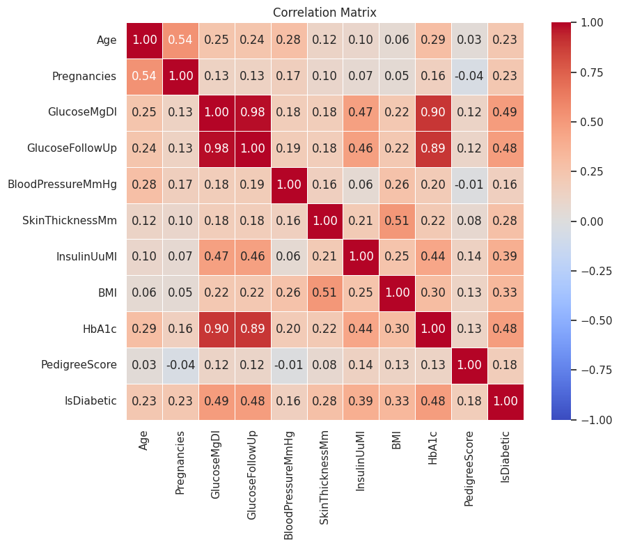
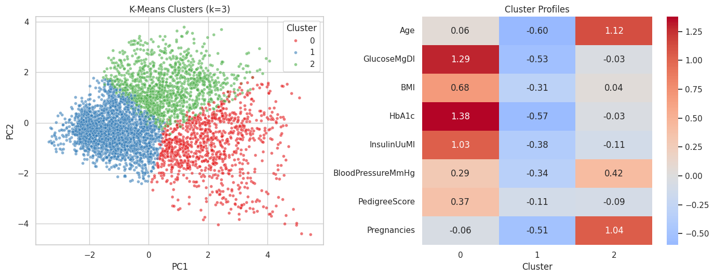

# Diabetes Data Analysis

End-to-end analysis of a 4,522-row diabetes dataset, covering data cleaning, exploratory analysis, statistical testing, and unsupervised risk segmentation.

## Highlights

- Cleaned inconsistent dates, units, decimal formats, missing values, outliers, and duplicates, producing 4,500 validated records.
- Explored clinical and lifestyle variables with grouped analysis, visualizations, and a correlation matrix.
- Applied Welch's t-test, Mann-Whitney, chi-square, ANOVA, paired tests, and Pearson/Spearman correlations.
- Used standardized features with K-Means and PCA to identify three distinct risk profiles.

## Key findings

- Glucose and HbA1c had the strongest association with diagnosis (correlations of about 0.49 and 0.48).
- The three clusters had diabetes rates of 14.4%, 43.7%, and 73.1%.
- The initial 23.1-point activity gap fell to 8.8 points after BMI adjustment; BMI explained about 62% of the crude gap.
- No significant difference was found between the five clinics.





## Tools

Python, pandas, NumPy, Matplotlib, Seaborn, SciPy, and scikit-learn.

## Run locally

1. Place an authorized copy of `diabetes_final_project.csv` beside the notebook.
2. Create and activate a virtual environment.
3. Install dependencies and open the notebook:

```bash
python -m pip install -r requirements.txt
jupyter lab diabetes_analysis.ipynb
```

The record-level CSV is intentionally excluded from this public repository. Results describe this dataset only and are not medical advice.

## Author

[Ron Barami](https://github.com/rdiol12)
